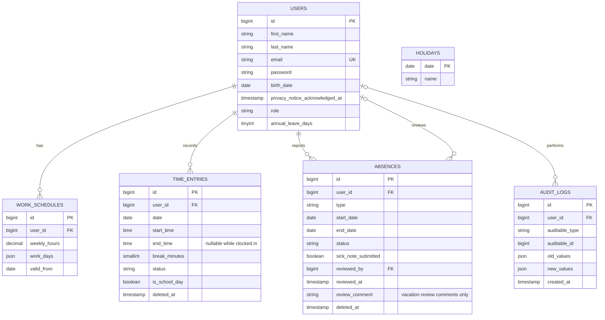

# CyTime data model

## Notes

- `work_schedules` is historical: `(user_id, valid_from)` is unique, and calculations must select the schedule valid on the date being evaluated.
- Time entries and absences use soft deletion. Their user foreign keys restrict hard deletion so related official records cannot be removed as a side effect.
- Clock-in creates an open time entry with a null `end_time`; clock-out fills it before the entry can count as worked time.
- Employee-submitted free text is not stored on absence reports; unstructured text on sickness records could capture protected health data.
- Optional supervisor review comments are stored only for vacation requests; comments on sick reports are rejected and never included in the audit snapshot.
- `audit_logs.auditable_type` and `auditable_id` form a polymorphic reference; snapshots of changed values are JSON.
- Leave-day defaults are stored on the user so supervisors can override the calculated entitlement.
- Registration stores the timestamp when the employee acknowledges the displayed privacy notice.
- Registration audits the initial employee role, calculated leave entitlement, and work schedule.
- Holidays use their date as the primary key; only NRW holidays should be inserted.
